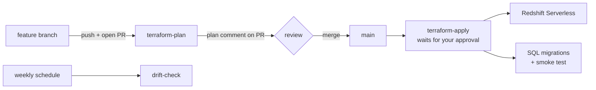

# Redshift Serverless with Terraform, GitHub Actions and Git branching

A small, real pipeline you can build, break and explain in an interview:

- **Terraform** creates an Amazon Redshift Serverless namespace and workgroup, a security group and a daily cost limit.
- **GitHub Actions** runs `terraform plan` on every pull request and posts the plan as a comment. Merging to `main` applies the change after you approve it, runs SQL migrations and a smoke test.
- **Git branching**: `main` is protected. Every change goes through a feature branch and a pull request.
- **A dedicated CI identity.** GitHub Actions signs in as an IAM user, `github-actions-ci`, with only the permissions the pipeline needs. Its keys are stored as encrypted GitHub secrets. (This account's organization policy blocks OIDC, the keyless option, so keys are the fallback; see "Why access keys, not OIDC" below.)



## Repository layout

| Path | What it does |
| --- | --- |
| `bootstrap/` | Run once, locally. Creates the S3 state bucket and gives the `github-actions-ci` user its permissions. |
| `infra/` | The Redshift stack that the pipeline manages. |
| `sql/migrations/` | Idempotent SQL, run in file-name order after every apply. |
| `sql/smoke_test.sql` | Post-deploy check. The deploy fails if it returns 0. |
| `scripts/run_sql.sh` | Runs a SQL file through the Redshift Data API. |
| `.github/workflows/` | `terraform-plan`, `terraform-apply`, `terraform-destroy`, `drift-check`. |

## Cost and safety

- Redshift Serverless bills compute in RPU-hours, metered per second with a 60-second minimum, while queries run. Storage is billed separately per GB-month. Check current rates on the [Redshift pricing page](https://aws.amazon.com/redshift/pricing/).
- If your AWS account has never used Redshift Serverless, AWS offers a [$300 credit to use within 90 days](https://aws.amazon.com/redshift/free-trial/).
- This stack uses the smallest base size (8 RPU) and a **daily limit of 4 RPU-hours**. Past that, the workgroup is switched off until the next day.
- The generated admin password lives in Secrets Manager, which has a small monthly charge per secret.
- **When you finish practising, run the destroy workflow** (step 8).

## Prerequisites

- An AWS account, and an admin user or SSO profile configured on your computer (`aws sts get-caller-identity` should work).
- [AWS CLI v2](https://docs.aws.amazon.com/cli/latest/userguide/getting-started-install.html), [Terraform](https://developer.hashicorp.com/terraform/install) 1.11 or later, and Git.
- A GitHub account. Optional: the [GitHub CLI](https://cli.github.com/) (`gh`).

> **Make the repository public.** GitHub's free plan gives public repositories branch protection and environment approvals, which this project uses. The repo holds no secrets, and you can show it in interviews. For a private repo, these features may need a paid GitHub plan.

The default region is Sydney (`ap-southeast-2`). To use another region, change `aws_region` in both `bootstrap/variables.tf` and `infra/variables.tf`, and use the same value for the `AWS_REGION` variable in step 3.

## Step 1 - Create an empty GitHub repository

On GitHub, create a new **public** repository named `redshift-terraform-cicd`. Don't add a README or licence; it must be empty. Don't push anything yet.

## Step 2 - Bootstrap AWS (once, from your computer)

First create the CI user and its access keys (skip this if you've already done it):

```bash
aws iam create-user --user-name github-actions-ci
aws iam create-access-key --user-name github-actions-ci
```

Copy the `AccessKeyId` and `SecretAccessKey` somewhere safe. You can't view the secret again, and you'll paste both into GitHub in step 3. Never commit them or paste them into a chat.

Then run the bootstrap:

```bash
cd bootstrap
terraform init
terraform apply -var="github_repo=<your-github-user>/redshift-terraform-cicd"
```

Type `yes` when asked. Note the `state_bucket` output.

Keep `bootstrap/terraform.tfstate` safe (it's git-ignored). You need it to remove these resources at the end.

## Step 3 - Configure the GitHub repository

Go to Settings > Secrets and variables > Actions.

**Secrets tab** (encrypted; nobody can read them back, not even you):

| Name | Value |
| --- | --- |
| `AWS_ACCESS_KEY_ID` | the `AccessKeyId` from step 2 |
| `AWS_SECRET_ACCESS_KEY` | the `SecretAccessKey` from step 2 |

**Variables tab:**

| Name | Value |
| --- | --- |
| `AWS_REGION` | `ap-southeast-2` |
| `TF_STATE_BUCKET` | the `state_bucket` output |

If you use the GitHub CLI, `terraform output -raw github_cli_commands` prints commands that set all four.

**Production environment.** Go to Settings > Environments > New environment and name it exactly `production`. Under **Required reviewers**, add yourself. Every apply and destroy will now pause until you approve it.

## Step 4 - First push and first deploy

From the project folder (not `bootstrap/`):

```bash
terraform fmt -recursive
terraform -chdir=infra init -backend=false
git init -b main
git add .
git commit -m "Initial Redshift Serverless pipeline"
git remote add origin https://github.com/<your-github-user>/redshift-terraform-cicd.git
git push -u origin main
```

`init -backend=false` creates `infra/.terraform.lock.hcl`, which pins the AWS provider version. It's included in the commit.

Open the **Actions** tab. `terraform-apply` waits for approval: open the run, choose **Review deployments**, then approve `production`. The first apply takes several minutes. It finishes by creating the `ops.pipeline_runs` table, loading sample rows and passing the smoke test.

**Check it yourself:** in the AWS console, open Redshift > Query editor v2. Connect to workgroup `rs-cicd-lab-dev-wg` and run `select * from ops.pipeline_runs;`.

## Step 5 - Protect `main`

Go to Settings > Rules > Rulesets > New branch ruleset:

- Target: the default branch, with enforcement **Active**
- **Require a pull request before merging** (0 approvals is fine when you work alone)
- **Require status checks to pass**, with the check `plan` added
- **Block force pushes**

From now on, nothing reaches `main` without a pull request and a green plan.

## Step 6 - The everyday branching workflow

```bash
git switch main && git pull
git switch -c feature/raise-usage-limit

# edit infra/terraform.tfvars: daily_rpu_hour_limit = 6
terraform fmt -recursive
git add infra/terraform.tfvars
git commit -m "Raise daily RPU-hour limit to 6"
git push -u origin feature/raise-usage-limit
```

1. Open a pull request (in the GitHub UI, or with `gh pr create --fill`).
2. `terraform-plan` runs. Read the plan comment: `~` means update in place, `+` create, `-` destroy, and `-/+` destroy and recreate.
3. Merge (squash merge keeps `main` history clean), then approve the `production` deployment.
4. Clean up locally:

```bash
git switch main && git pull
git branch -d feature/raise-usage-limit
```

Branch naming: `feature/...` for changes, `fix/...` for repairs, `hotfix/...` for urgent fixes to production.

## Step 7 - Practice exercises

Each one gives you a real story for the interview.

| # | Branch | What to do | What you learn |
| --- | --- | --- | --- |
| 1 | `feature/raise-usage-limit` | Step 6 above | Reading a plan, approval-gated deploys |
| 2 | `feature/load-errors-table` | Add `sql/migrations/003_create_load_errors.sql` with an idempotent `create table if not exists` | Infra plan shows "No changes", but the deploy still runs your SQL |
| 3 | `fix/formatting` | Indent a line in `infra/main.tf` badly and push | CI fails on `terraform fmt -check`; run `terraform fmt -recursive` to fix it |
| 4 | none | Change the usage limit in the Redshift console, then run **drift-check** from the Actions tab | Drift detection; then decide whether to revert by re-applying or to change the code to match |
| 5 | `feature/rename-namespace` | Change `namespace_name` in `infra/main.tf` and open a PR | The plan shows `-/+` (destroy and recreate, which loses data). Close the PR without merging |
| 6 | `fix/revert-limit` | `git revert <merge-commit>` of exercise 1, then open a PR | Rolling back through Git instead of clicking in the console |
| 7 | two branches | Edit the same line of `terraform.tfvars` on two branches and merge one, then `git rebase main` the other | Resolving a merge conflict |

## Step 8 - Tear down

1. Actions > **terraform-destroy** > Run workflow, type `destroy`, then approve `production`.
2. Actions > **drift-check** > the `...` menu > **Disable workflow**.
3. Delete the CI user's keys so they can't be misused later: IAM > Users > `github-actions-ci` > Security credentials > Access keys > Actions > Delete.
4. Optional, to remove everything: empty the state bucket in the S3 console (it's versioned, so the console's **Empty** button is easiest). Then run this from `bootstrap/`:

```bash
terraform destroy -var="github_repo=<your-github-user>/redshift-terraform-cicd"
```

## Troubleshooting

| Error | Fix |
| --- | --- |
| `Credentials could not be loaded` in a workflow | Check that the two secrets are named exactly `AWS_ACCESS_KEY_ID` and `AWS_SECRET_ACCESS_KEY`, with no spaces in the values. |
| `AccessDenied` for an action during apply | The error names the action. If it mentions a service control policy, the organization blocks it and the code must avoid it. Otherwise add it to `data "aws_iam_policy_document" "deploy"` in `bootstrap/main.tf` and re-apply the bootstrap. That's least-privilege tuning in practice. |
| Precondition fails: needs subnets in three AZs | The region's default VPC is missing or has fewer subnets. Run `aws ec2 create-default-vpc`, or pick another region. |
| SQL fails with the workgroup unavailable | You hit the daily RPU-hour limit. It resets the next day, or raise `daily_rpu_hour_limit` through a PR. |
| `Error acquiring the state lock` | Another run holds the lock, or a cancelled run left it behind. Wait for the other run, or run `terraform force-unlock <LOCK_ID>` locally after a backend init. |
| `terraform fmt -check` fails | Run `terraform fmt -recursive` and commit the result. |

## Why access keys, not OIDC

The best practice is OIDC: GitHub gets short-lived AWS credentials for each run, and nothing long-lived is stored. This account sits in an AWS-managed organization whose service control policy denies `iam:CreateOpenIDConnectProvider`, so the pipeline uses the fallback: one IAM user with tightly scoped permissions, keys stored only as GitHub encrypted secrets, and the keys deleted when the lab ends.

## Talking points for the interview

- **Working within guardrails**: the account's service control policy blocked OIDC, so I used a dedicated, narrowly scoped CI user with keys in encrypted GitHub secrets. With OIDC allowed, I'd switch to short-lived credentials and separate plan and apply roles.
- **Least privilege**: the CI user gets read-only access plus only the write actions the Redshift stack needs, never AdministratorAccess. Production deploys still wait for approval in the `production` environment.
- **Remote state with S3 native locking** (`use_lockfile`), since DynamoDB-based locking is deprecated in Terraform.
- **Plan as the review artefact**: reviewers see exactly what will change. The apply job re-plans on `main` and applies that saved plan.
- **Guardrails**: a daily usage limit with `deactivate`, input validation, a precondition that fails fast, and serialised applies with `concurrency`.
- **Idempotent SQL and a smoke test**, so every deploy is safe to rerun and proves the database works.
- **Drift detection**: a weekly plan with `-detailed-exitcode` catches manual console changes.
